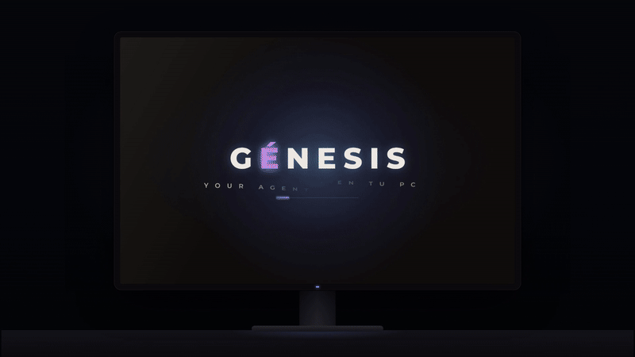

# GÉNESIS · beta

  

  <a href="https://systemorlando.github.io/genesis-app/"><b>▶ Ver el recorrido interactivo</b></a> ·
  <a href="docs/genesis-beta.mp4">Video completo (MP4)</a> ·
  <a href="../../releases/latest"><b>Descargar la beta</b></a>

**GÉNESIS es un agente de escritorio: le pides algo en palabras normales y lo hace en tu computadora.** Abre programas, busca y ordena archivos, escribe documentos, programa y usa tus servicios (Gmail, Drive, Calendar, GitHub, Notion, Canva y más). No es un chat: es un asistente que *actúa* en tu PC, con los permisos que tú le das. Lo desarrolla **Brakescode**.

> **Esta es una versión beta.** Puede tener errores o cambiar de un día a otro. Si algo falla, cuéntanos: tu reporte decide qué arreglamos primero.

## Por qué GÉNESIS

**En una frase:** un agente que *hace* el trabajo en tu computadora, que **recuerda lo que hablaron aunque cambies de motor de IA**, que puedes usar gratis y en el que tú pones los límites.

### Lo que lo hace distinto

- **Una memoria que no se pierde al cambiar de motor.** Cada orden corre en un proceso nuevo del motor (OpenCode, Claude, ChatGPT, Gemini o tu modelo local), y ese proceso no recuerda nada de la orden anterior. Por eso la memoria vive en GÉNESIS, no en el motor: guarda los datos que importan, un resumen comprimido de lo antiguo y los últimos intercambios, y se los pone delante a **cada** orden. Cambias de motor, de plan o de modelo, cierras y abres la app, y el hilo sigue («otra vez», «ese archivo»). En Ajustes hay un botón **Probar memoria** que comprueba que al motor le llegó entera.
- **Actúa, no solo responde.** Abre programas, busca y ordena archivos, escribe documentos, programa, usa el teclado y el ratón y trabaja en tus servicios (Gmail, Drive, Calendar, GitHub, Notion, Canva y más). Cada paso queda en el **Historial**: qué herramienta usó, con qué y cuánto tardó.
- **El motor que quieras, sin pelearte con claves de API.** Gratis con OpenCode (sin cuenta); con el plan que ya pagas de Claude, ChatGPT o Gemini, a través de la herramienta oficial de cada empresa (GÉNESIS no lee ni guarda tus credenciales); o con un **modelo local** en tu PC, sin límites de uso y sin internet. Una orden se queda con un solo motor de principio a fin: no cambia a mitad de camino.
- **Tú pones los límites.** Niveles de control del ordenador, rutas protegidas, apps vetadas, horario permitido y una palabra clave para lo delicado. En cada conector, cada herramienta se permite, se pregunta o se bloquea. Lo que le impides queda impedido también por el servidor de herramientas de GÉNESIS, no solo "pedido" en el texto de la orden.
- **Un equipo, no un solo agente.** Varios agentes trabajan a la vez sobre tu proyecto, cada uno en su propia copia y rama para no pisarse. O **compiten** (la misma tarea a varios motores gratuitos: basta con que uno acierte) o **se reparten** la tarea. Un revisor automático comprueba el trabajo y tú decides qué integrar.
- **Más de 1000 conectores.** Un catálogo de más de 60 con un clic, los que comparte la comunidad (revisados por una persona antes de entrar) y cualquier servidor MCP publicado en GitHub, que GÉNESIS busca y te ayuda a conectar. Cada cuenta guarda sus propios conectores.
- **Tus datos se quedan en tu PC.** Archivos, conversaciones, memoria y claves viven en tu computadora (las claves, en el almacén de claves del sistema). GÉNESIS solo manda a internet lo que le pides.
- **Ágil.** Mantiene el motor encendido entre órdenes, con sus herramientas ya conectadas: en las mediciones del equipo de desarrollo, una orden con OpenCode tardó 2,7 s en engancharse frente a 5,2 s en frío.
- **Hecho para estudiantes y equipos pequeños, en tu idioma.** Pensado para laptops normales (por ejemplo, una RTX 3050 con 16 GB de RAM). La app está en español, inglés y portugués, con voz natural que corre en tu PC.
- **Windows y Linux, con actualizaciones firmadas.** Un clic y se actualiza; GÉNESIS comprueba que la actualización la firmó Brakescode antes de instalarla.

### Ejemplos de lo que se le pide

- *"Resume los correos de hoy de mis profesores y agenda las entregas en mi calendario."*
- *"Arregla el error de la API de pagos y corre las pruebas."*
- *"Ordena mi carpeta de Descargas por tipo de archivo."*
- *"Haz una presentación de 6 diapositivas sobre IA en el Perú para mi curso."*

## Qué tiene cada apartado

| Apartado | Qué hace | Lo que ganas |
|---|---|---|
| **Ahora** | Le das una orden por escrito o por voz y ves lo que va haciendo | Resultados en tu PC, no solo texto |
| **Historial** | Cada conversación con sus pasos: qué herramienta usó, con qué y cuánto tardó | Transparencia: sabes qué hizo en tu computadora |
| **Conectores** | **Más de 1000 conectores**: un catálogo de más de 60 con un clic (Gmail, Drive, Calendar, GitHub, Notion, Canva…), los que comparte la comunidad y cualquier servidor MCP de GitHub, que GÉNESIS busca y conecta por ti | Que haga cosas en tus servicios, no solo en tu PC |
| **Permisos** | Por cada herramienta: permitir, preguntar o bloquear | Control fino de lo que puede tocar |
| **Skills** | Instrucciones expertas (PDF, Excel, presentaciones, diseño, programación); algunas ya vienen incluidas | Mejores resultados en tareas concretas |
| **Comunidad** | Skills y conectores que comparte la gente; puedes publicar los tuyos | Aprovechar lo que ya armaron otros |
| **Equipo** | Varios agentes en paralelo sobre un proyecto, con revisión | Tareas grandes más rápido y con menos errores |
| **Directrices** | Qué no puede tocar y cuándo: rutas, apps, horario, palabra clave | Seguridad sobre un asistente que controla tu PC |
| **Avatar** | Nombre, ojos, voz natural y accesorios (chullo, lentes, bufanda…) | Un asistente con personalidad |
| **Ajustes** | Motor (OpenCode gratis o tu plan), modelo local, memoria, modo programación, voz e idioma | Que se adapte a tu equipo y a tu bolsillo |
| **Mensajes de mejora** | Botón BETA: ideas y errores llegan directo al equipo | Que la beta se construya contigo |

Además: **memoria** que sigue el hilo aunque cambies de motor, **modo programación** con método de ingeniería (explorar, cambiar, probar, verificar), **adjuntos** (archivos e imágenes en la orden) y **actualizaciones firmadas** con un clic.

## En qué se parece y en qué se diferencia

GÉNESIS no compite con todo lo que hay: hace una cosa distinta. Esta comparación es para que elijas lo que te conviene, y dice también dónde otros son mejores.

| | **GÉNESIS** | **OpenRouter** | **Apps de chat** (ChatGPT, Claude, Gemini) | **Agentes de código** (Claude Code, Codex CLI, Cursor) | **Ejecutores locales** (Ollama, LM Studio) |
|---|---|---|---|---|---|
| **Qué es** | Agente de escritorio que ejecuta tareas | Puerta de entrada (API) a cientos de modelos con una sola clave | Chat para conversar, con algunas herramientas | Agentes para programar, en terminal o editor | Corren modelos en tu PC y ofrecen chat o API |
| **Actúa en tu PC y tus servicios** | **Sí**: archivos, programas, pantalla, teclado, conectores | No: devuelve texto a tu programa | Limitado | Sobre todo tu proyecto de código | No: dan el modelo, la acción la pones tú |
| **Memoria entre órdenes y al cambiar de motor** | **Sí, propia**: es la misma con cualquier motor y sobrevive a reiniciar | Su API no la ofrece: cada llamada es independiente y tu programa arma el contexto | Propia de cada app; no se lleva a otra empresa | De cada herramienta o proyecto, de un solo proveedor | Ninguna |
| **Cambiar de modelo o motor** | Desde Ajustes, sin perder la memoria | **Su fuerte**: cientos de modelos con una sola clave | Solo los de esa empresa | Los del proveedor (algunos permiten más) | Los modelos que tengas descargados |
| **Cómo se paga** | Gratis con OpenCode, o tu plan actual; modelo local sin costo | Por uso: créditos y tokens | Suscripción de cada empresa | Plan o API de cada uno | Gratis |
| **Claves de API** | No hace falta pegarlas | Sí, una por cuenta | No | Según el plan | No |
| **Control de lo que puede tocar** | Permisos por herramienta, rutas protegidas, apps vetadas, horario, historial de cada paso | Lo pone tu programa | El de la app | El de cada herramienta | No aplica |
| **Varios agentes a la vez con revisión** | **Sí**: Equipo (competir o repartir) | No | No | Depende de la herramienta | No |
| **Elígelo cuando…** | Quieres que *haga* cosas por ti, con límites claros y sin gestionar claves | Eres desarrollador y quieres elegir y cambiar modelos desde tu código | Quieres conversar, redactar o analizar sin que toque tu PC | Tu trabajo es principalmente programar | Quieres el modelo y armar el resto tú mismo |

**La diferencia central con OpenRouter:** OpenRouter te da *acceso a modelos* a cambio de pagar por uso y manejar una clave de API; no hace nada en tu computadora y no guarda lo que hablaron: eso lo resuelve quien programa encima. GÉNESIS es el *agente* que usa un modelo para hacer tareas, **recuerda entre órdenes aunque cambies de motor**, y puede usar el plan que ya pagas, uno gratuito o uno local. Son capas distintas: el modelo y el agente.

**Con las herramientas de código** (Claude Code, Codex, Cursor): GÉNESIS las usa como motor si las tienes, y suma lo que ellas no cubren: Gmail, Drive y Calendar, ordenar archivos, usar programas, voz, un equipo de agentes con revisión y controles pensados para quien no es programador.

**Lo que GÉNESIS todavía no es:** está en beta; Windows es la versión más probada, la de Linux es nueva (ver abajo) y todavía no hay para Mac; la calidad del resultado depende del modelo que uses (un modelo local pequeño rinde menos que uno en la nube); y el código no es abierto (ver la licencia).

## Descargar e instalar

### Windows 10 u 11 (64 bits)

1. Entra en **[Releases → la última versión](../../releases/latest)** y baja `GENESIS-<versión>-setup.exe`.
2. Ábrelo. No pide permisos de administrador: se instala solo para tu usuario.
3. **Si Windows muestra «Windows protegió tu PC»:** pasa porque el instalador todavía no tiene un certificado de firma de código de pago, no porque tenga un virus. Haz clic en **Más información → Ejecutar de todas formas**. Baja GÉNESIS solo desde esta página: así sabes que es el original.
4. Al abrir la app por primera vez, lee y acepta los términos, inicia sesión con Google o GitHub y sigue la guía rápida (puedes verla otra vez desde **Ajustes → Versión y guía**).

### Linux (64 bits) · beta nueva
Hay dos formatos en la misma [página de descargas](../../releases/latest). Elige uno:

- **`GENESIS-<versión>-linux-amd64.deb`** (Ubuntu 22.04 o más nuevo, Debian, Linux Mint…): `sudo apt install ./GENESIS-<versión>-linux-amd64.deb`. Instala también lo que le falta del sistema.
- **`GENESIS-<versión>-linux-x86_64.AppImage`** (cualquier distribución): `chmod +x GENESIS-<versión>-linux-x86_64.AppImage` y ábrelo con doble clic o `./GENESIS-<versión>-linux-x86_64.AppImage`. Se actualiza solo desde la propia app.

Necesita un escritorio con **WebKitGTK 4.1** (viene en Ubuntu 22.04+ y Fedora actuales; el `.deb` lo pide solo). Para que el agente maneje el escritorio instala, según lo que uses:

| Para… | Instala | Nota |
|---|---|---|
| Teclado y ratón | `xdotool` | Solo en sesiones **X11**; en Wayland no funcionan |
| Enfocar y listar ventanas | `wmctrl` | Solo X11 |
| Portapapeles | `xclip` (X11) o `wl-clipboard` (Wayland) | |
| Capturar la pantalla | `gnome-screenshot`, `scrot` o `grim` | Cualquiera de los tres |

`sudo apt install xdotool wmctrl xclip gnome-screenshot` cubre lo habitual en X11. Si falta algo, GÉNESIS te dice cuál paquete instalar en vez de fallar sin explicar.

**Lo que en Linux funciona igual:** las órdenes, el historial, los conectores y su catálogo, las skills, la comunidad, el equipo de agentes, las directrices, la memoria, los motores (OpenCode, Claude, ChatGPT, Gemini), el avatar, las actualizaciones firmadas y los mensajes de mejora.

**Lo que cambia en Linux:** no existe el nivel «Administrador» del control del ordenador (sí «Normal», «Completo» y «Control total»); la terminal es `bash` en vez de PowerShell; el modelo local corre directamente, sin WSL; y todavía no se probó en todas las distribuciones y escritorios. Si algo falla en la tuya, cuéntanos cuál usas.

**Qué necesitas (Windows y Linux):**
- Un motor de IA. **OpenCode es gratis y no pide cuenta**: se instala desde Ajustes → Proveedores. Si tienes Claude, ChatGPT o Gemini, también sirven.
- Opcional: un **modelo local** que corre en tu propia PC, sin límites de uso y sin internet (Ajustes → Modelo local). Va mejor con una tarjeta gráfica NVIDIA (por ejemplo una RTX 3050) y 16 GB de RAM o más.

## Actualizaciones

GÉNESIS busca versiones nuevas al abrirse y cada 6 horas. Cuando hay una, aparece una banda arriba con **«Actualizar ahora»**: la baja, comprueba que la firmó Brakescode y la instala. Un archivo cambiado por el camino no pasa la comprobación y no se instala. La app se cierra y vuelve a abrir sola.

## Cuéntanos qué mejorar

Usa el botón **BETA** de la barra superior, o **Ajustes → Mensajes de mejora**: ideas, errores, conectores o skills que te faltan. Llega al equipo de Brakescode. Si dejas tu correo, te respondemos.

¿Prefieres el correo? Escribe a **contacto@brakescode.com**.

## Tu privacidad

- Tus archivos, conversaciones y claves se quedan en tu PC. Las claves se guardan en el llavero del sistema.
- GÉNESIS solo manda a internet lo que le pides: a tu motor de IA, a los servicios que conectaste y, si nos escribes, tu mensaje.
- En los mensajes de mejora solo va lo que escribes y, si marcas la casilla, la versión de la app, el sistema operativo y el motor que usas.

## Licencia

GÉNESIS es software propietario: se licencia, no se vende. Puedes instalarlo y usarlo en las computadoras que controlas. **No** está permitido descompilarlo, aplicarle ingeniería inversa, redistribuirlo, modificarlo ni usarlo para entrenar modelos de IA. El texto completo, con los términos de la beta, está en [LICENSE](LICENSE), y los componentes de código abierto que usa, con sus licencias, en [THIRD_PARTY_NOTICES.md](THIRD_PARTY_NOTICES.md).

Este repositorio solo publica los instaladores: el código fuente de GÉNESIS no es público.

© 2026 SystemOrlando · Brakescode. Todos los derechos reservados.
